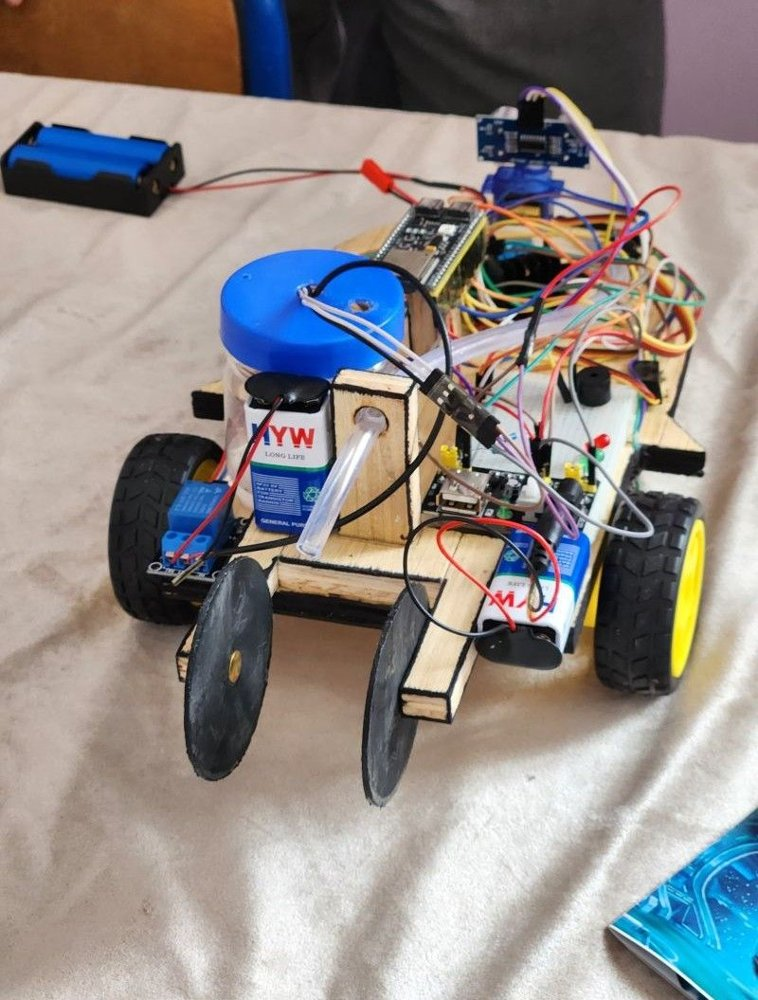
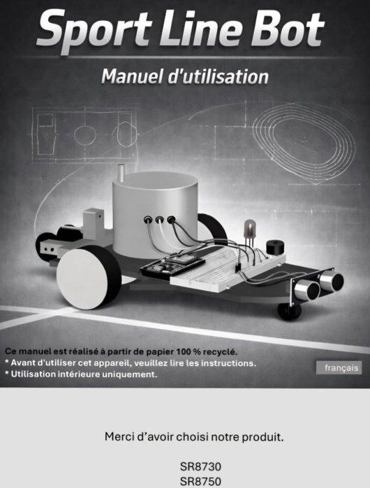
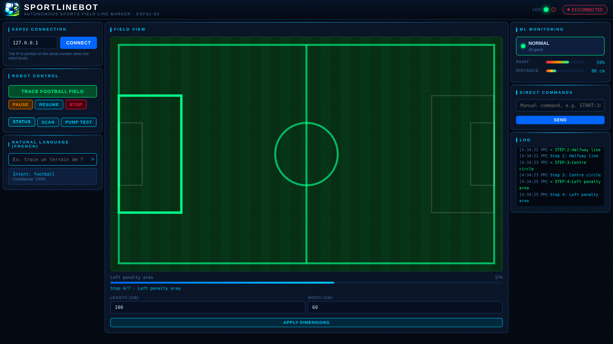

# SportLineBot

Autonomous sports-field line-marking robot (ESP32-S3) controlled from a Flask web dashboard with a natural-language (French) command interface and ML-based anomaly monitoring.

[](#overview)
[](#hardware)
[](#architecture)
[](#dashboard)
[](#quick-start)
[](#limitations)
[](#authors)


<p align="center">
  
  
</p>

## Overview

SportLineBot marks the lines of a sports field without human effort. The robot drives and sprays paint on its own; an operator supervises it from a browser, either with buttons or by typing a sentence in French such as "trace un terrain de foot".

The project was built at the **MECA WORLD CUP** (national robotics competition, 2026), organised by the [Club Mecatronique ENSA Tetouan](https://www.linkedin.com/company/club-m%C3%A9catronique-ensat%C3%A9/home/). The team received a certificate of participation.

The prototype works at reduced scale. The firmware implements the football field; other sports are a design goal, not implemented.

## Authors

| Name | Role |
|------|------|
| [Abdessamad Ait Brahim](https://github.com/abdessamadaitbrahim) | Data and AI: dashboard, NLP, anomaly detection, communication protocol |
| [Abdelaaziz Ait Kheri](https://www.linkedin.com/in/abdelaaziz-ait-kheri-887a57324/) | Mechatronics: chassis, electronics, firmware integration |

## Hardware

| Component | Purpose | Pin |
|-----------|---------|-----|
| ESP32-S3 | Controller, WiFi, WebSocket server (port 81) | - |
| L298N + DC motors | Drive and turning | IN1=5, IN2=18, IN3=21, IN4=4 |
| HC-SR04 on a servo | Obstacle detection and 0-180 degree scan | TRIG=13, ECHO=12 (1k/2k divider), servo=14 |
| Paint pump | Line marking | 26 |
| Analog paint-level sensor | Paint percentage | ADC 1 |
| Green / red LEDs, buzzer | Status feedback | 6 / 2 / 3 |

## Architecture

```
Browser (dashboard)  <--Socket.IO-->  Flask server  <--WebSocket :81-->  ESP32-S3
                                      |- NLP intent classifier
                                      |- Anomaly detection (rules + Isolation Forest)
```

- **Firmware** (`firmware/robot_code`): text protocol over WebSocket, time-based open-loop motion, safety stops.
- **Server** (`server/`): relays commands, reconnects automatically (exponential backoff up to 30 s), polls `STATUS` every 5 s when idle.
- **NLP** (`server/nlp_robot.py`): TF-IDF character n-grams + Multinomial Naive Bayes on about 130 French phrases, 8 intents (football, stop, pause, resume, paint level, status, pump test, scan). Accents are stripped before classification.
- **Anomaly detection** (`server/ml_anomaly.py`): hard rules first (paint empty, obstacle close, paint low, robot stuck), then an Isolation Forest trained on synthetic normal data.
- **Football field**: traced in 7 reported steps (outer rectangle, halfway line, centre circle, both penalty areas, both goal areas). Curves are approximated by short segments.

### Safety

| Condition | Behaviour |
|-----------|-----------|
| Obstacle under 15 cm | Robot stops, alert sent |
| Paint at or below 3 % | Pump refused |
| Paint at or below 10 % | Warning |

### Protocol

Commands: `START:<cm>`, `MOVE:<cm>`, `TURN_RIGHT:<deg>`, `TURN_LEFT:<deg>`, `STOP`, `PAUSE`, `RESUME`, `STOP_PUMP`, `CIRCLE:<r>`, `HALF_CIRCLE:<r>:<RIGHT|LEFT>`, `ARC:<r>:<a0>:<a1>`, `SCAN`, `STATUS`, `PUMP_TEST`, `CALIB_CM:<n>`, `CALIB_DEG:<n>`, `DIMENSIONS:<L>:<W>`, `FOOTBALL_FIELD`, `IP`.

Replies: `READY`, `OK:*`, `ERR:*`, `STATUS:<paint>:<distance>`, `ALERT:<type>`, `BEGIN:FOOTBALL_FIELD`, `STEP:<n>:<name>`, `DONE:FOOTBALL_FIELD`, `POS:<x>:<y>`.

## Dashboard



Live field view with step-by-step progress, ML status, gauges for paint and distance, direct commands, natural-language input and an event log. Screenshot taken with the mock ESP32 (see below).

## Quick start

### 1. Run the dashboard without hardware

```bash
python -m venv venv
source venv/bin/activate        # Windows: venv\Scripts\activate
pip install -r requirements.txt
cp .env.example .env            # optional

python tools/mock_esp32.py      # terminal 1: fake robot on port 81
python server/server.py         # terminal 2
```

Open http://127.0.0.1:5000, enter `127.0.0.1`, click Connect, then Trace football field.

### 2. Flash the real robot

```bash
cp firmware/robot_code/secrets.example.h firmware/robot_code/secrets.h
```

Edit `secrets.h` with your WiFi credentials (git-ignored), open `robot_code.ino` in the Arduino IDE, flash the ESP32-S3, read the IP in the serial monitor and enter it in the dashboard.

### Configuration

| Variable | Default | Description |
|----------|---------|-------------|
| `SECRET_KEY` | random | Flask secret key |
| `HOST` | `127.0.0.1` | Server bind address |
| `PORT` | `5000` | Server port |

## Documents

- [Preselection sheet](docs/documents/preselection-sheet.pdf): project submission for the MECA WORLD CUP.
- [Presentation](docs/documents/presentation.pdf): project presentation slides.

## Limitations

- Motion is open loop and time-based (`MS_PER_CM`, `MS_PER_DEG`); it must be calibrated with `CALIB_CM` and `CALIB_DEG`. There is no gyroscope or PID heading correction in this firmware.
- Only the football field is implemented.
- The anomaly model is trained on synthetic data, not real field data.
- The NLP model understands French only.

## Repository structure

```
sportlinebot/
|-- firmware/robot_code/    ESP32-S3 firmware and secrets template
|-- server/                 Flask app, NLP, anomaly detection, templates, static
|-- tools/mock_esp32.py     Fake robot for testing
|-- models/                 Generated models (git-ignored)
|-- docs/images/            Screenshots and photos
|-- requirements.txt
`-- .env.example
```

## Author

**Abdessamad Ait Brahim** - [github.com/abdessamadaitbrahim](https://github.com/abdessamadaitbrahim)
